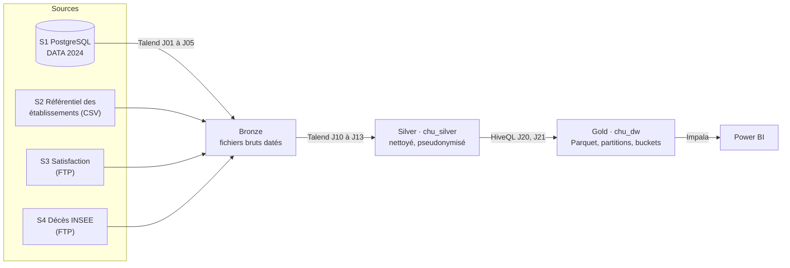

# Cloud Healthcare Unit : entrepôt de données décisionnel

Entrepôt de données du groupe hospitalier CHU : un lakehouse en trois couches (Bronze, Silver, Gold) sur la VM Cloudera QuickStart du bloc, interrogé avec Hive et Impala, restitué dans Power BI. Dans la maquette du livrable 2, la Silver est alimentée par des scripts SQL (`chargement/`) ; Talend reste la cible de production.

Projet fil rouge du bloc « Stockage et Big Data », CESI FISA Informatique A4, groupe 3 : Tilal Messaoudi (chef de groupe), Nawfel, Ayoub et Georges.

## Architecture



| Couche | Emplacement | Contenu | Écrite par |
|---|---|---|---|
| Bronze | HDFS `/datalake/bronze/` | Copie brute et datée de chaque source | Talend, J01 à J05 |
| Silver | HDFS `/datalake/silver/`, base `chu_silver` | Données nettoyées, typées, pseudonymisées | Talend, J10 à J13 |
| Gold | Base Hive `chu_dw`, en Parquet | Constellation de 4 faits et 6 dimensions, plus 2 agrégats | HiveQL, J20 et J21 |
| Restitution | Power BI, connecteur Impala | Tableaux de bord des praticiens et de la direction | Livrable 3 |

## Pile technique

| Outil | Version | Rôle |
|---|---|---|
| Cloudera QuickStart (CDH) | 5.12 | HDFS, YARN, Hive 1.1, Impala 2.9, Hue |
| Talend Open Studio for Big Data | 7.3.1 | Cible de production : ingestion (Bronze) et nettoyage (Silver) |
| PostgreSQL | 18 | Source S1, restaurée depuis DATA 2024 |
| Power BI Desktop | dernière version | Tableau de bord |

## Contenu du dépôt

```text
.
├── sql/                              scripts Hive et Impala, dans l'ordre d'exécution
│   ├── 00_bases.sql                  bases chu_bronze, chu_silver et chu_dw
│   ├── 01_silver_ddl.sql             tables externes Silver : le contrat avec Talend
│   ├── 02_gold_ddl.sql               constellation Gold : Parquet, partitions, buckets
│   ├── 03_j20_dimensions.sql         J20 : dimensions à clés stables, membre -1
│   ├── 04_j21_faits.sql              J21 : faits en partitions dynamiques
│   ├── 05_agregats_stats.sql         agrégats mensuels et statistiques
│   ├── 06_j22_impala_refresh.sql     J22 : métadonnées et statistiques d'Impala
│   └── 07_j30_controles_qualite.sql  J30 : intégrité, complétude, FINESS, doublons
├── chargement/                       chemin de la maquette, sans Talend
│   ├── 01_extraction_s1.sql          DATA 2024 vers les fichiers Silver (PostgreSQL)
│   ├── 02_depot_hdfs.sh              dépôt des fichiers dans HDFS
│   ├── 03_qualite_source.sql         mesures de qualité à la source (PostgreSQL)
│   └── 04_controles_gold.sql         contrôles de la Gold par Impala
├── bench/                            benchmark avant et après optimisation
│   ├── 00_base_avant.sql             base chu_bench_brut, sans aucune optimisation
│   ├── 00_base_avant_impala.sql      la même base, construite par Impala
│   ├── 01_base_partitions.sql        base chu_bench_part, partitions seules (facultatif)
│   ├── requetes/                     8 KPI, Q9 et 2 variantes sur agrégats
│   ├── run_bench.sh                  exécutions répétées, durées écrites dans un CSV
│   ├── explain.sh                    plans d'exécution de chaque requête
│   └── graphiques.py                 médianes, synthèse et graphique
├── talend/                           jobs exportés et modèle de contexte
└── resultats/                        résultats agrégés du benchmark et des contrôles
```

## Ordre d'exécution

Les scripts se lancent dans la VM, depuis la racine du dépôt : clone le dépôt dans la VM, ou copie-le avec WinSCP. On peut aussi coller un script dans l'éditeur Hive de Hue.

1. **Sources** : restaurer DATA 2024 dans PostgreSQL, déposer les fichiers S2, S3, S4 et ceux du COG dans le dossier des sources, puis copier `talend/contexts/chu.properties.example` en `chu.properties` et le remplir.
2. **Bases et tables Silver** :
   ```bash
   HIVE="beeline -u jdbc:hive2://quickstart.cloudera:10000 -n cloudera"
   $HIVE -f sql/00_bases.sql
   $HIVE -f sql/01_silver_ddl.sql
   ```
3. **Silver** : dans la maquette, extraction dans PostgreSQL puis dépôt dans HDFS, voir [chargement/README.md](chargement/README.md). En production : jobs Talend J01 à J05, puis J10 à J13 (ou J00_orchestrateur).
4. **Gold** :
   ```bash
   for s in 02_gold_ddl 03_j20_dimensions 04_j21_faits 05_agregats_stats; do
     $HIVE -f sql/$s.sql || break
   done
   ```
   Dans Talend, J20 et J21 exécutent les mêmes instructions, une par tHiveRow.
5. **Impala** : `impala-shell -i quickstart.cloudera -f sql/06_j22_impala_refresh.sql`
6. **Contrôles** : `$HIVE --force=true -f sql/07_j30_controles_qualite.sql`. Attendu : 0 orphelin et 0 doublon de clé. Dans la maquette, plus rapide : `chargement/03_qualite_source.sql` dans PostgreSQL et `chargement/04_controles_gold.sql` dans Impala.
7. **Benchmark** : voir [bench/README.md](bench/README.md).

## Ce que couvre le livrable 2

| Exigence du sujet | Dans le dépôt |
|---|---|
| Scripts DDL et DML commentés et versionnés, avec l'intégrité référentielle | `sql/00` à `sql/05`, jobs dans `talend/`, contrôles dans `sql/07` |
| Partitionnement et indexation, justifiés pour le moteur | `sql/02` (partitions, buckets triés, Parquet), `sql/05` (statistiques, agrégats) |
| Rapport de qualité : complétude, FINESS, doublons | `sql/07`, `chargement/03` et `chargement/04`, résultats dans `resultats/qualite/` |
| Au moins 5 requêtes de benchmark | `bench/requetes/` : les 8 KPI, une requête à 4 jointures et 2 variantes sur agrégats |
| Graphiques avant/après et leur analyse | `bench/`, résultats dans `resultats/benchmark/` (graphique `avant_apres_retenues.png`) |

## Conventions

- **Noms** : minuscules, sans accents ni espaces. Tables `dim_`, `fait_` et `agg_`. Jobs `Jnn_zone_objet` : 0x pour l'ingestion, 1x pour Silver, 2x pour Gold, 30 pour le contrôle.
- **Fichiers Silver** : séparateur point-virgule, sans en-tête, encodés en UTF-8, dates au format `yyyy-MM-dd`, champ vide lu comme NULL.
- **Scripts** : un en-tête (rôle, job, entrée, sortie), un commentaire par bloc, un `;` à la fin de chaque instruction.
- **Pièges de Hive 1.1** : jamais de commentaire entre l'instruction précédente et un `SET`, jamais de commentaire après un `;` sur la même ligne, jamais de `;` dans un commentaire ou dans une chaîne. Sinon Hue et Beeline découpent ou interprètent mal le script.
- **Le schéma Silver est un contrat** : `sql/01_silver_ddl.sql` fixe ce que Talend écrit et ce que la Gold lit. On ne le modifie qu'en accord avec le chef de groupe.

## Règles du dépôt (RGPD et sécurité)

- Aucune donnée : ni sauvegarde, ni fichier source, ni fichier de l'INSEE, ni Parquet, ni `.pbix`. Le `.gitignore` les bloque.
- Aucun secret : le sel de pseudonymisation est saisi au lancement de l'extraction et n'est écrit nulle part ; pour Talend, les mots de passe restent dans `talend/contexts/chu.properties`, ignoré par Git.
- Dans `resultats/`, seulement des agrégats : durées, comptages et pourcentages.

## Travailler à plusieurs

```bash
git pull --rebase
git add sql/04_j21_faits.sql
git commit -m "J21 : rattachement de fait_deces aux régions du COG"
git push
```

Un commit par sujet, avec un message qui dit ce qui change. Fais toujours un `git pull --rebase` avant de commencer. Chacun travaille sur ses fichiers : si tu dois toucher au fichier d'un autre, préviens-le avant.

## Dépannage

| Symptôme | Cause probable | Solution |
|---|---|---|
| Un `SET` échoue dans Hue ou Beeline | Un commentaire juste avant le `SET` | Déplacer le commentaire après le `SET` |
| Impala ne voit pas une table | Métadonnées d'Impala périmées | `INVALIDATE METADATA chu_dw.<table>;` |
| Talend n'écrit pas dans HDFS | Le DataNode annonce une adresse interne à la VM | Fichier hosts du PC et `dfs.client.use.datanode.hostname=true` (voir `talend/README.md`) |
| Le chargement d'un fait manque de mémoire | Trop de partitions écrites en même temps | Charger une année à la fois (voir l'en-tête de `sql/04`) |
| Des `id_temps` orphelins dans J30 | Dates hors de la plage du calendrier | Élargir la plage de `dim_temps` dans `sql/03` |
